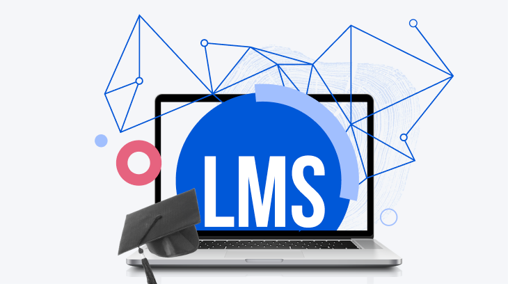

# LMS Application

At Switchfully we would like to have a modern Learning Management System to help everyone involved have the best learning experience.
For us it is very important that both following as teaching a course is pleasant experience.

Therefore we want to build an **LMS application**.

## High level analysis

Before the start of the project we typically conduct a High Level Analysis (HLA) phase.
The goal of this phase is to provide just enough upfront analysis to start the project without defining the complete blueprint of the application.
No coding!

### Business drivers (The Why)

The main **business drivers** for the application are:

- A overview of available courses and its details
- Tracking progression of students
- Fast and clear feedback system
- Easy to use

### Diagrams

In order to communicate about the architecture make use of diagrams. 
For inspiration you can take a look at the C4 Model (Simon Brown). 

## Non-functional requirements

### Project constraints

- Follow the SCRUM framework
    - Project kickoff
    - Sprint kickoff
    - Daily standup ((rotating) SCRUM master role)
    - Backlog refinement sessions at specific times with product owner (coaches)
    - Sprint review (Sprint backlog overview + Demo)
    - Retrospective
- These tools can be useful:
    - Scrum board (sprint backlog, user stories, technical tasks, story leads/pairs, impediments, ... )
        - Project backlog (up to date!) (user stories, technical tasks, ...)
        - Sprint backlog (estimated + commitment)
        - eg. Trello
    - a "Definition Of Done"
    - Walking skeleton (from frontend to backend)
    - Diagram

### Technology constraints
- Create a new GitHub repository
- Follow REST conventions (with JSON as the message / body format)
- Use Swagger to provide a readable document of your web-API
- A build pipeline (GitHub actions or Jenkins)
- Front-end: Angular
- Database: PostgreSQL
- Testing:
    - Goal: min. 80% coverage
    - Use a variety of tests (not just E2E tests)
- Authentication: Keycloak

#### For Java
- Use Spring Boot or Quarkus

#### For .NET
- Use ASP.NET Core Web Api
- Use AzureDevops for continuous integration
- Perform logging (use logging provided by .NET Core)
    - Certainly log all interactions with the application that can be defined as "errors"
        - E.g.: unauthorized access, illegal arguments, exceptions in general,...
- [Switchfully intake app](https://dev.azure.com/Switchfully-Intake/Switchfully-intake-app "Azure DevOps")
